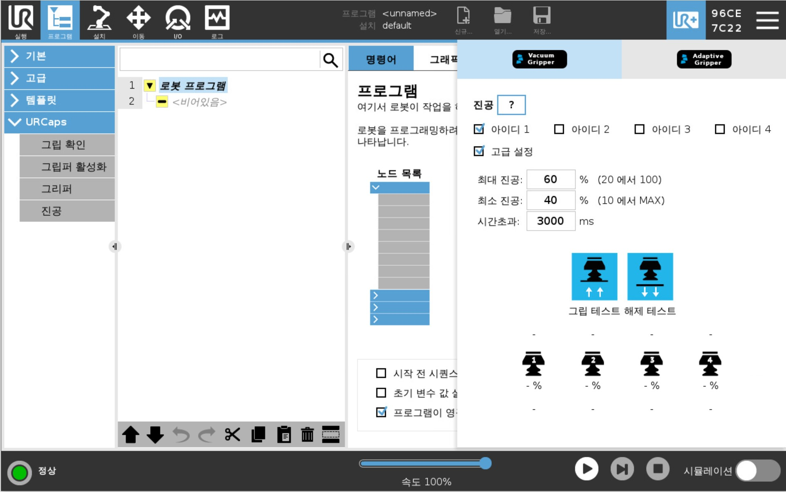
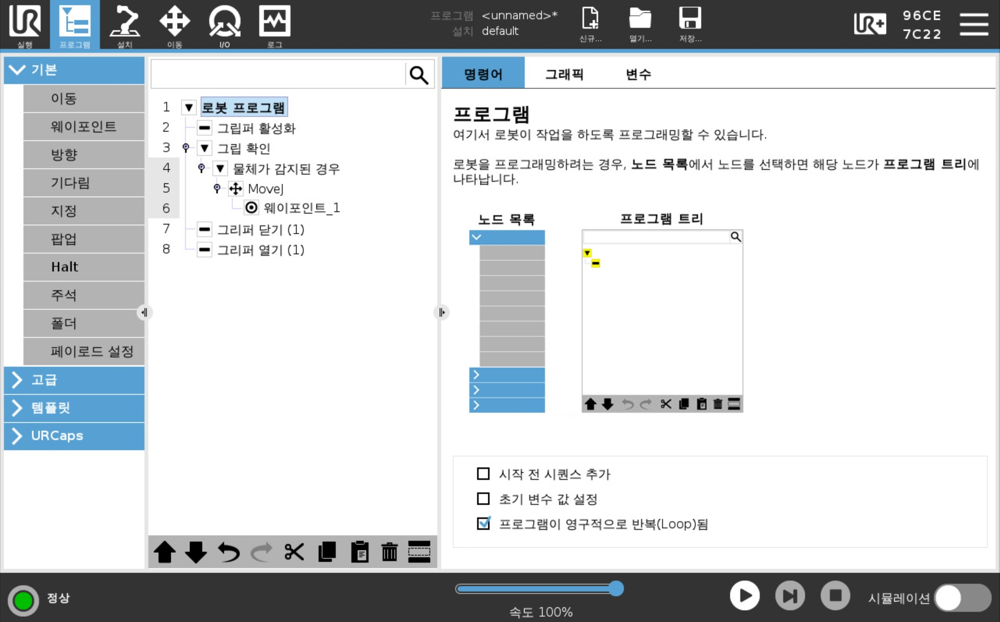
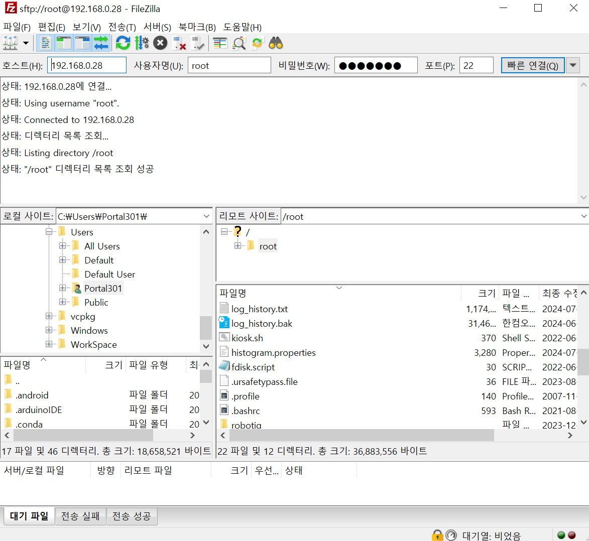
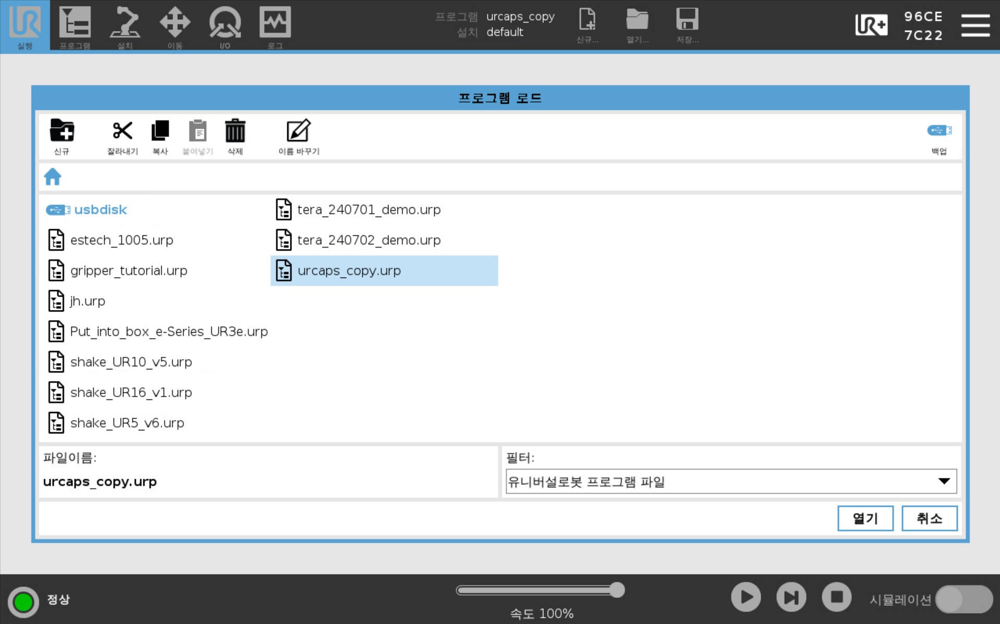

# Lecture 1: 엔드이펙터 제어 (URCaps)
## 강의 목표
UR로봇의 기능을 확장해주는 URCaps를 원격으로 활용해봅시다.

## URCaps
URCaps는 UR 로봇 시리즈를 위한 소프트웨어 프레임워크입니다. URCaps는 플러그인과 같은 역할을 하며, 사용자가 로봇의 기능을 확장하고 사용자 정의할 수 있도록 돕습니다. 이를 통해 다양한 기능을 추가하거나 기존 기능을 개선할 수 있습니다. 

## URCaps 파일을 로봇에서 불러오는 방법
0. URCaps 기능이 정상적으로 동작하는지 확인합니다.
<div align="center">
  
</div>

1. Polyscope에서 새 프로그램을 생성합니다.

2. 프로그램에 URCaps 관련 노드를 추가합니다.
<div align="center">
  
</div>

3. 프로그램을 저장합니다.

4. 프로그램(**.script 파일**, .urp 파일 아님)을 컴퓨터로 전송합니다. 두가지 방법을 소개드립니다.

    Method #1: FileZilla 이용
    
      FileZilla Client를 설치해주세요. (다운로드 링크: https://filezilla-project.org/)

      [호스트/사용자명/비밀번호/포트]를 각각 [로봇IP/root/easybot/22] 으로 입력해주세요.

      "/programs" 경로로 이동 후 방금 작성한 프로그램의 .script 파일을 복사해주세요.


<div align="center">
  
</div>

 
  Method #2: USB Memory 이용

  필터를 모든프로그램으로 변경후 .script파일을 복사해주세요.


<div align="center">
  
</div>


5. 에디터(VScode)에서 프로그램을 엽니다.

### 실습

'example_pristine.script'와 'example_urcaps_onrobot_rg2ft.script'을 비교해 봅니다.

어떤 차이점이 존재하나요?


## URCaps 함수 수정해보기

### 실습

'scriptfile.py'를 이용하여 UR로봇으로부터 가져온 스크립트를 실행해보고, 원래의 프로그램(.urp)와 동일하게 동작하는지 확인해봅시다.

이전 예제(~lecture3)에서 연습한 내용을 바탕으로 복사해온 script 파일을 수정해보세요. (원본을 백업해두는걸 잊지마세요!)


## 스크립트 구조 살펴보기

[`scripts/gripper_open_close.script`](./scripts/gripper_open_close.script)는 펜던트에서 `RG2-FT Grip` 노드 2개(열기, 닫기)만 넣고 만든 프로그램입니다. 열어보면 크게 세 부분으로 나뉩니다.

| 줄 | 내용 |
|---|---|
| 1 ~ 55 | 로봇 기본 설정 (TCP, 입출력, 중력, 페이로드 등) |
| 56 ~ 3128 | `# begin: URCap Installation Node` ~ `# end: URCap Installation Node`<br>그리퍼 설정과 **`rg2ft_grip()` 함수 정의** |
| 3129 ~ | 본문: `rg2ft_grip(...)` 호출 |

Installation Node 안에는 `rg2ft_grip()` 함수가 정의되어 있습니다.
```python
def rg2ft_grip(width,force,tool_index=0,blocking=True,depth_comp=False,popupmsg=True):
```
- `width`: 손가락 사이 폭(mm). 크면 열리고, 작으면 닫힙니다.
- `force`: 잡는 힘(N)

이 함수 정의가 없으면 본문에서 `rg2ft_grip(...)`를 부를 수 없으므로, **Installation Node는 지우지 않습니다.**


## 그리퍼 열고 닫기

본문은 아래 5줄이 전부입니다.
```python
  rg2ft_grip(100.0, 40.0, tool_index=0, blocking=True, depth_comp=False, popupmsg=True)    # 열기 (폭 100mm)
  rg2ft_payload_set(mass=0.0, tool_index=0, use_guard=True)
  sleep(1.0)
  rg2ft_grip(20.0, 40.0, tool_index=0, blocking=True, depth_comp=False, popupmsg=True)     # 닫기 (폭 20mm)
  rg2ft_payload_set(mass=0.0, tool_index=0, use_guard=True)
```
- `rg2ft_payload_set(...)`은 물체 무게를 로봇에 알려주는 줄입니다. 그리퍼 노드마다 자동으로 들어가며, 여기서는 무게를 0으로 둡니다.

1. `scriptfile.py`의 `script_path`를 바꿉니다.
```python
    script_path = "scripts/gripper_open_close.script"
```
2. 펜던트를 **원격제어(Remote) 모드**로 두고, `lecture1` 폴더에서 실행합니다.
```bash
cd Session2_gripper_urcaps/lecture1
python scriptfile.py
```

#### 실행 결과
- 그리퍼가 100mm로 열리고, 1초 뒤 20mm로 닫힙니다.

### 더 해보기
- 폭을 바꿔서 그리퍼가 조금만 열리게 해보세요.
- 힘(`force`)을 바꿔서 물체를 잡아보세요. 힘이 너무 크면 어떻게 될까요?

